<div align="center">




</div>

## 🎯 The problem

Trucks and containers leave half full, or a second trip is booked, because the load is stacked by eye. Fridges get
something heavy on top, and at the second shop the driver has to unload the third shop's goods to reach the right
boxes.

**Load Planner** takes the list of boxes (size, number, weight, how much each can carry on top, "this side up", and
which drop-off it is for) and the vehicle, and works out **where every box goes and in what order to load it**:
fully supported, within the weight limits, last stop deepest in. The loaders get a **3D step-by-step guide**, a
printable **loading sheet** and an **Excel manifest**.

## ✨ What it does

| Tab | What you get |
|---|---|
| 📦 **Plan a load** | demo load or your Excel list; vehicle presets or your own size; the plan in 3D (boxes fly in through the door in loading order, hover for details); boxes loaded, space used, weight, balance checks; comparison with careful loading by hand; PDF loading sheet and Excel manifest |
| 🚚 **Several vehicles** | too much for one vehicle: which vehicles and how many trips, at what cost, against the same choice loaded by hand |
| 🧪 **Benchmark** | the 1,500 standard test loads against published results |
| ℹ️ **How it works** | the method and the rules it keeps, in plain words |

## 📸 The app

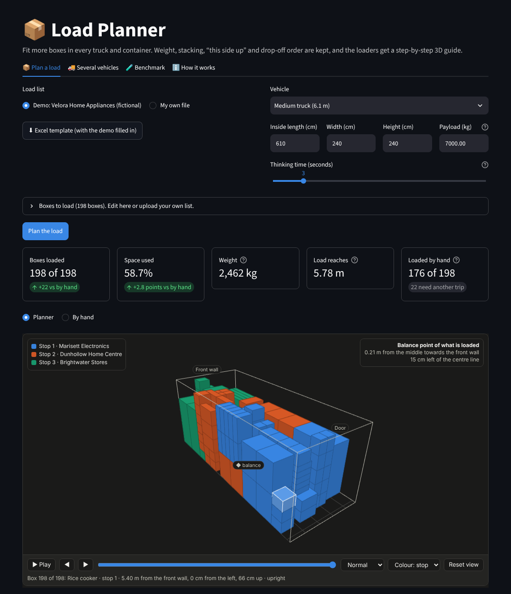

| **Mid-way through loading, coloured by item** | **Loaded by hand: 22 boxes left for another trip** |
|:---:|:---:|
| 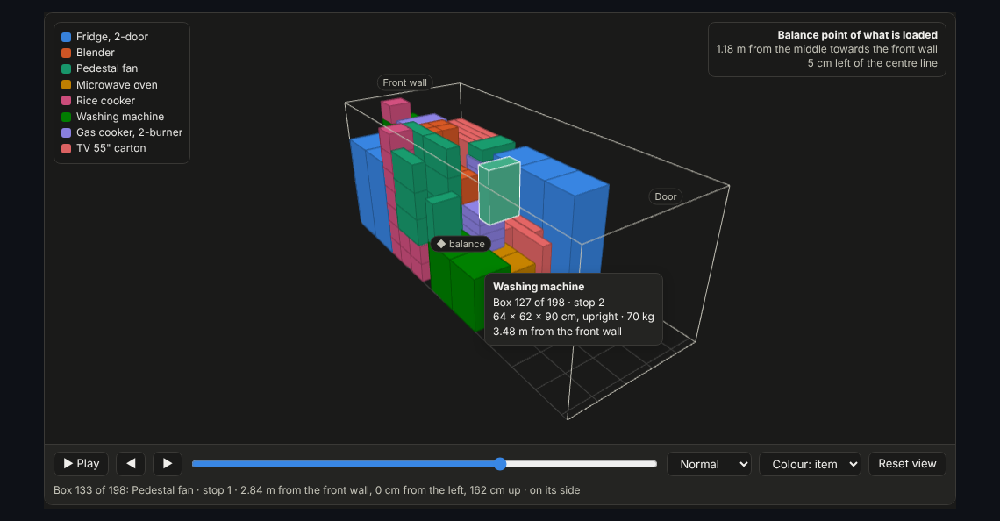 | 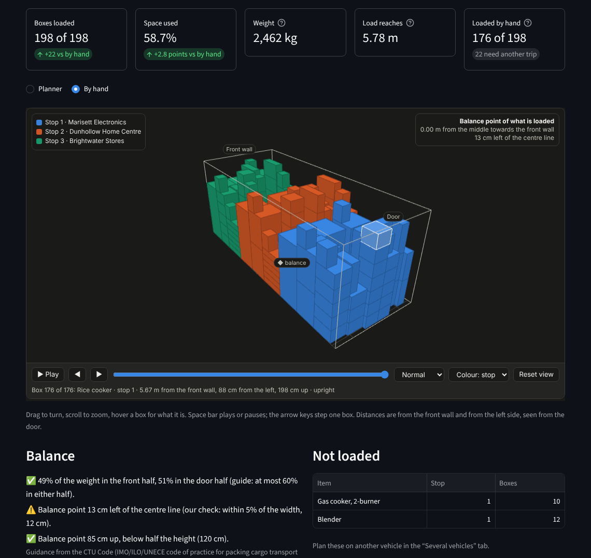 |
| **Part load in a 40 ft container, moved to the middle** | **Several vehicles** |
| 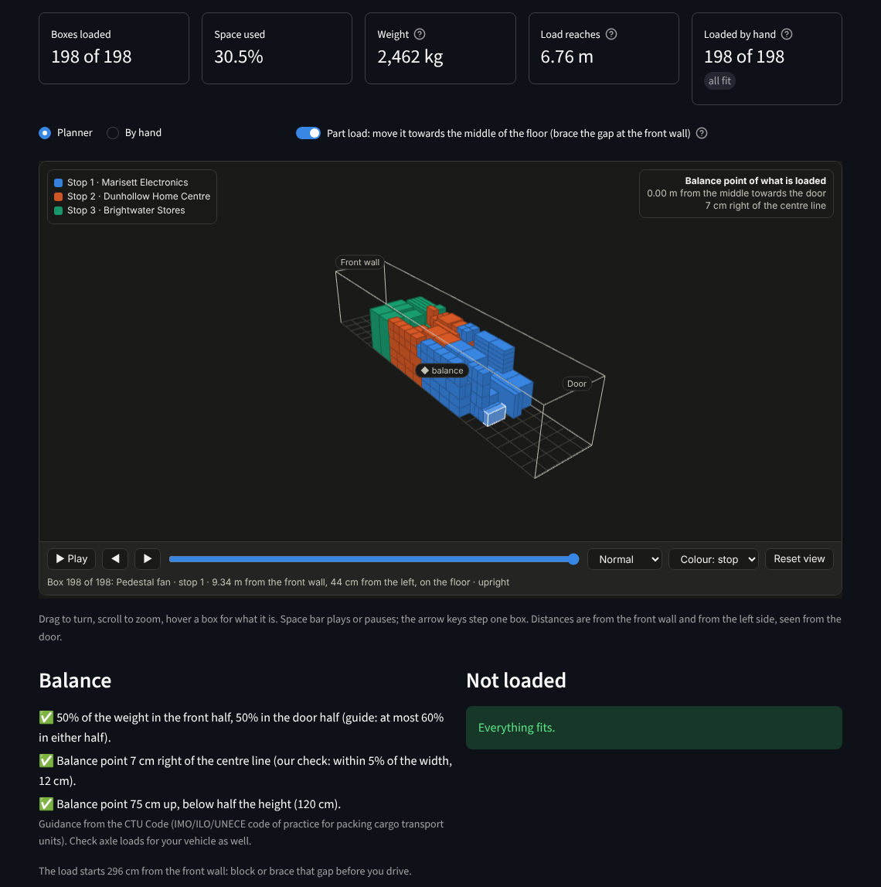 | 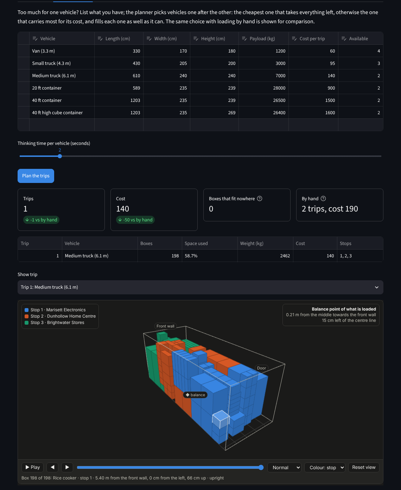 |
| **The load list** | **Benchmark** |
| 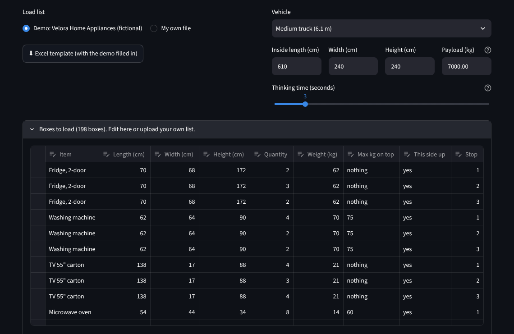 | 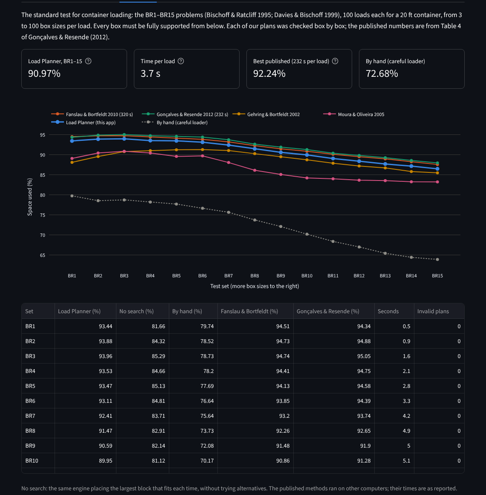 |

**The loading sheet (PDF):** a cover with the numbers and the whole load, then the steps in groups: boxes already
loaded in grey, the next ones numbered in colour, and for each box where it goes and what it rests on.

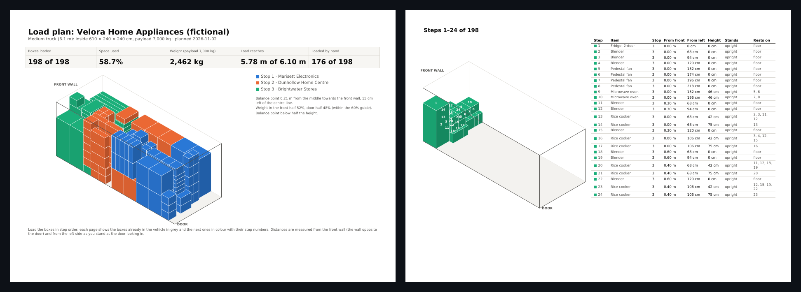

## 🧪 Benchmark


The standard test for container loading: BR1–BR15 (Bischoff & Ratcliff 1995; Davies & Bischoff 1999), 100 loads
each for a 20 ft container (587 × 233 × 220 cm), from 3 to 100 box sizes per load, with the allowed orientations of
every box. Every box must be **fully supported** from below. Published results with full support are from Table 4
of Gonçalves & Resende (2012); every plan here was **checked box by box** before it counted (0 invalid of
4,500).

| | BR1–7 (few box sizes) | BR8–15 (many sizes) | BR1–15 | Time per load |
|---|---:|---:|---:|---:|
| Gonçalves & Resende 2012 (BRKGA, best published) | 94.53% | 90.23% | 92.24% | 232 s |
| Fanslau & Bortfeldt 2010 (tree search) | 94.22% | 89.88% | 91.91% | 320 s |
| **Load Planner** | **93.40%** | **88.85%** | **90.97%** | **3.7 s** |
| Gehring & Bortfeldt 2002 (parallel GA) | 90.43% | 87.69% | 88.97% | |
| Moura & Oliveira 2005 (GRASP) | 89.73% | 84.13% | 86.74% | |
| Same engine, no search | 84.23% | 80.63% | 82.31% | < 0.1 s |
| By hand (a careful loader, simulated) | 77.88% | 68.13% | 72.68% | |

In 3.7 s per load on a 2-core computer (two loads at a time), Load Planner is above every method in the table published before 2010 on all 15 sets, and 1.27 points below the best published result, which took 232 s per load. It uses 18.3 points more of the container than the simulated careful loader; the look-ahead search adds 8.7 points over the same engine without it.

## 🧠 How it works


| Step | In plain words |
|---|---|
| **Blocks** | Boxes of one kind are grouped into stacks, rows and layers, or two such blocks side by side or one on the other (Fanslau & Bortfeldt 2010). |
| **Free spaces** | The empty room is kept as the largest empty boxes, each with a full floor, so every box ends up fully supported; spaces of the same height that touch are joined (Gonçalves & Resende 2012). |
| **Look ahead** | For the next free space the planner tries several blocks, finishes the load quickly for each, and keeps the one that fills most; with time left it tries 2, 4, 8, … up to 1,024. Compiled with numba. |
| **Weight** | Each box has a limit spread over its top; every free space knows how much more pressure its floor can take, all the way down. Fragile boxes get nothing on top; the payload is never exceeded. |
| **Drop-offs** | The last stop is packed first, deepest in; nothing for an earlier stop may go behind it in its lane, so each stop's boxes come out without moving anyone else's. |
| **Balance** | Centre of gravity, the CTU Code's guide of at most 60% of the weight in either half of the length, and for part loads the option to move the load towards the middle. |

## 🚀 Quick start

```bash
git clone https://github.com/harshadulshan/load-planner.git
cd load-planner
pip install -r requirements.txt
streamlit run app.py
```

The demo (a fictional distributor with three shops) plans itself. For your own load, fill in
[`sample_data/load_template.xlsx`](sample_data/load_template.xlsx): Boxes (one row per item and stop) and
Vehicles. The first plan on a computer takes about 15 s more while the engine compiles.

## ✅ Verified

```bash
python tests/verify_engine.py       # 59 checks: the checker, benchmark loads, weights, stops, by hand, fleet, files
python tests/verify_app.py          # 25 checks: clicks through the app with the demo
python tests/mutation_test.py       # 26 planted bugs, each must be caught
python benchmarks/run_br.py         # the benchmark (data downloaded on first use, checked by SHA-256)
```

- **Box by box:** inside the vehicle, no overlaps, full support, allowed orientations, box counts, payload, the
  weight on every box (also a small box pressing on one spot), nothing on fragile boxes, and the drop-off order.
- **Loading order:** every box goes in after what it rests on and after what is behind it.
- **Mutation test:** 26 bugs planted one at a time (weight limits ignored, a space above a block wider than
  its top, stops packed the wrong way round, a lenient checker, names that break the 3D page, ...). All caught.

## 📚 Sources

- J. F. Gonçalves, M. G. C. Resende (2012). A parallel multi-population biased random-key genetic algorithm for a
  container loading problem. *Computers & Operations Research* 39(2). [Preprint](https://optimization-online.org/wp-content/uploads/2010/07/2688.pdf)
- T. Fanslau, A. Bortfeldt (2010). A tree search algorithm for solving the container loading problem. *INFORMS
  Journal on Computing* 22(2).
- F. Parreño, R. Alvarez-Valdes, J. M. Tamarit, J. F. Oliveira (2008). A maximal-space algorithm for the container
  loading problem. *INFORMS Journal on Computing* 20(3).
- E. E. Bischoff, M. S. W. Ratcliff (1995); A. P. Davies, E. E. Bischoff (1999): the BR test problems, via
  [OR-Library](https://www.brunel.ac.uk/~mastjjb/jeb/orlib/thpackinfo.html).
- IMO/ILO/UNECE Code of Practice for Packing of Cargo Transport Units (CTU Code), on weight distribution.

## 📄 License

MIT. The demo company, shops and loads are fictional.
